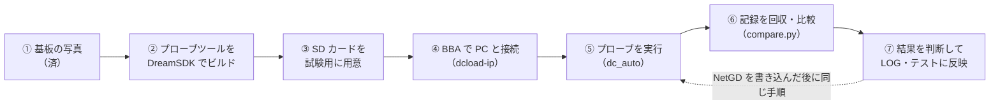

# 純正 GDEMU の調査フロー

純正ファームのままの GDEMU 6.0 から、NetGD の開発に必要な「正解データ」を集める手順。
PC と GDEMU を直接つながず、**Dreamcast + ブロードバンドアダプタ（BBA）**だけで行う。

| 段階 | 誰が | どこで | 成果物 |
|------|------|--------|--------|
| ① 写真 | ユーザー | — | `docs/boards/gdemu60/`（**済**） |
| ② ビルド | ユーザー（2026-11-21 からは Claude が DreamSDK のある PC で） | DreamSDK のある PC | `gdprobe.elf` |
| ③ SD の用意 | ユーザー | PC | 試験用の SD カード |
| ④ 接続 | ユーザー | Dreamcast + BBA + PC | dcload-ip が起動した状態 |
| ⑤ 実行 | ユーザー（`dc_auto` が自動化） | 同上 | 記録ファイル（`/pc/` 経由で PC に保存） |
| ⑥ 回収・比較 | ユーザーが記録を渡す → Claude | このリポジトリ | 比較結果 |
| ⑦ 判断・反映 | Claude（Opus がレビュー） | このリポジトリ | `LOG.md` の項目、`discimg` のテストの期待値、ファームの修正 |

---

## 安全のルール（最初に読む）

- 純正ファームは吸い出せず、壊れたら元に戻せない。**プローブは読み取り系のコマンドしか送らない**（許可リストは `tools/gdprobe/README_ja.md`）。
- イメージの切替（`52 82`）は openMenu と同じ操作なので安全だが、**設定ファイルで明示したときだけ**行う。
- 未知のベンダーコマンド、未知の `0x52` サブコマンド、セカンダリ（2台目の IDE）への送信は**しない**。
- SWD 端子への配線や ERASE パッドには**触らない**（純正ファームが消える）。この調査は配線なしで完結する。
- SD カードは調査用に別の1枚を用意する。普段使いのカードの中身は変えない。

---

## ① 基板の写真（済）

`docs/boards/gdemu60/README.md`：MCU は ATSAM3U2E、FPGA は AGM AG16KDDF256、外付けの SPI フラッシュは無し。
基板の中身（配線、FPGA の起動方式）は Dreamcast 側からは見えないので、この先の②〜⑦では分からない。それは G1-2（導通確認）で別に調べる。

## ② プローブツールのビルド（DreamSDK のある PC）

- ソース：`tools/gdprobe/`。KallistiOS 2.3.0 に合わせてある（ユーザーのフォーク KallistiOS-VisualNovel と同じ版）。
- ビルド方法・設定ファイルの書き方：`tools/gdprobe/README_ja.md`（設定の雛形は `gdprobe.cfg.example`）。
- 作業の詳しい手順とチェック表：実機作業ガイド（Artifact）https://claude.ai/artifact/9gr3qLhDo54ME1XmiXuyDN （非公開。リポジトリにも `docs/research/user-tasks.html` として同じものを置く）。
- `$env:BBA_TOOLS` に Dreamcast-Dev-Tools-for-BBA の場所を入れてから `.\tools\gdprobe\build.ps1`（`gdprobe.elf` と `host\gdprobe.cfg` ができる）。
- このリポジトリの PC では KOS をビルドできないので、**初回のビルドでエラーが出たら、そのまま全文を Claude に渡す**。

## ③ SD カードの用意

本家の決まりどおり、MBR パーティションありの FAT32、ルートに番号フォルダを置く（スーパーフロッピー形式は起動しない）。
どのイメージで何が分かるかの対応：

| フォルダ | 中身 | 分かること |
|----------|------|------------|
| `01` | GDmenu か openMenu（普段どおり） | メニュー。ここから `02` を選ぶ |
| `02` | **dcload-ip のディスク**（固定 IP 版。ユーザーの `make_dcload_disc.ps1` で作れる） | プローブを BBA で送り込むため。プローブは RAM 上で動くので、起動後に別のイメージへ切り替えてよい |
| `03` | GD-ROM の GDI（`tools/mksdcard` が作る合成イメージ） | GD-ROM の TOC・REQ_SES（**D-4**：セッション数は1か2か）、IP.BIN の読み出し、読み込み速度とシーク時間 |
| `04` | **トラック2本の CDI**（音声 + データ。`mksdcard` が作る合成イメージ） | **D-1**：セッション2を返すか（NetGD は今 ABRT） |
| `05` | トラック3本の CDI（音声2 + データ。`mksdcard`） | D-1 の対照、CDI の lead-out と pregap（**D-5**） |
| `06` | CD 音声トラックのある GDI（音声3本。`mksdcard`） | GET_SCD の形式（**D-2**）、REQ_STAT（**D-3**） |
| `07` | **空のフォルダ**（イメージなし） | 切替先にイメージが無いとき純正がどうするか（R18 の欠陥1と同じ状況） |

- **`03`〜`06` は `tools/mksdcard` が生成する**（`python tools/mksdcard/mksdcard.py OUTDIR --menu <普段の 01> --dcload <dcload-ip の CDI>`。手順・diskpart・限界は `tools/mksdcard/README_ja.md`）。
  合成データなので著作物は含まず、起動はしない。`01` / `02` は自分のカードのものを `--menu` / `--dcload` で入れる。`07` は空のフォルダ（コピーで落ちたら手で作る）。
- 純正が mksdcard の CDI を受け付けるかは未確認で、それ自体が調査結果になる。動作確認済みの自作ソフトの CDI があれば、任意で 1 本追加してよい。
- PC 側の比較（⑥）で照合するので、**`NETGD-PROBE-MANIFEST.json`（と生成した OUTDIR）を PC に残しておく**。市販ディスクから作ったイメージを使う場合は、そのファイルを PC にも残す。

## ④ BBA で PC と接続

ユーザーの Dreamcast-Dev-Tools-for-BBA の手順どおり（直結、固定 IP、ファイアウォールの許可）。

1. 管理者で `scripts\setup_pc_network.ps1`（初回だけ）。
2. Dreamcast を起動 → GDmenu / openMenu で dcload-ip のディスクを選ぶ。
3. dcload-ip の画面に IP が出たら準備完了。

注意（KNOWHOW より）：ping が返っても dcload が空いているとは限らない。前のプログラムを途中で止めた後は、電源を入れ直してから始める。

## ⑤ プローブの実行

- `dc_auto` のプリセット `tools/gdprobe/profiles/gdprobe.ps1` を使う（または `dc_run` で `gdprobe.elf` を直接送る）。
- dcload-ip は `02` のディスクから起動するので、起動直後にマウントされているのは dcload-ip のディスクになる。
  調べたいイメージ（`03`〜`07`）へは、**プローブ自身が `52 82 n` で切り替える**（openMenu がゲームを起動するときと同じ操作）。
  プローブの設定ファイルで「切替試験」を有効にし、調べるフォルダ番号の一覧（例：`3,4,5,6,7`）を書くと、1回の実行で順に
  「切替 → READY を待つ → 読み取り系の試験一式」を繰り返す。切替を無効にすると、dcload-ip のディスクだけを調べる。
- 最後に `02`（dcload-ip のディスク）へ切り替えて戻しておくと、次の実行の準備になる。
- 記録は `/pc/` 経由で PC のフォルダに保存される（4 KB ずつ書くので dcload-ip は固まらない）。
- 記録は `tools\gdprobe\host\gdprobe_<label>_<日時>.txt`（時計が無ければ `seq<番号>`）。`label=stock` / `label=netgd` で機器を区別する。
- **段階的に広げる**：1回目は `switch=off`（dcload-ip のディスクだけ）→ 2回目は `switch=on`・`images=3` → 3回目に `images=3,4,5,6,7`・`return_to=2`。

## ⑥ 記録の回収と比較

- 記録ファイルを、このリポジトリの `docs/research/probe-records/` に置く（またはチャットに渡す）。
- 比較：
  - 純正の記録どうし（同じイメージを2回）→ 値がぶれる項目（時間など）を見分ける。
  - 純正 vs NetGD（NetGD を書き込んだ後）→ `compare.py a.txt b.txt`。
  - データの完全性 → `compare.py --image <SD に入れたのと同じ .gdi/.cdi> <記録>`。
  - mksdcard のイメージの完全性 → `compare.py --manifest OUTDIR/NETGD-PROBE-MANIFEST.json <記録>`（イメージのファイルは不要。期待値をマニフェストと生成コードから再計算し、不一致を「イメージ・LBA」単位で出す）。

## ⑦ 結果の判断と反映

| 調べたいこと | 記録のどこを見るか | 反映先 |
|--------------|---------------------|--------|
| D-1〜D-5（NetGD が仕様や Flycast と違う応答） | REQ_SES・GET_TOC・GET_SCD・REQ_STAT の生バイト | 純正に合わせるかを決め、`common/discimg` のテストの期待値を純正の値にしてからファームを直す |
| `0x52` の挙動（R10 の未解決） | `52 00` の応答、`52 82` 後の SENSE の並びと READY までの時間 | `ide.rs` の `handle_gdemu_cmd`、切替後の UA の出し方 |
| 本家の性能の基準値（G3-3） | コマンドの時間、CD_READ のスループット、シーク時間 | `docs/PLAN.md` G3-3 の目標値 |
| 純正でもバスのビット化けがあるか | セクタのハッシュの不一致 | G1 バスのタイミング調査（上流で報告されたビット化け） |
| 空のフォルダへの切替 | `07` への切替結果 | R18 の欠陥1の修正方針の確認 |

- 結果はすべて `docs/research/LOG.md` に新しい `R` 項目として記録する（CLAUDE.md のルール）。
- 判断は Opus が行い、必要なら Fable に記録の読み解きと照合を任せる。

---

## 実際にやって分かった注意点（2026-11-21〜22、LOG R117〜R130）

- **G1 バスの保護**：gdprobe は `cdrom_init` を走らせないので、そのままでは G1 のレジスタがすべて同じ値（`0xae`）に読める。
  今の gdprobe はプローブの前に保護を開ける（記録のヘッダ `# g1bus prot_before=.. prot_after=3`）。`prot_before=0` は、前の実行のあと Dreamcast がリセットされたしるし。
- **`cdread_flags` はイメージの種類に合わせる**：純正は期待セクタ種別を検査する。GD-ROM（Mode 1）は `0x24`、CDI（Mode 2 Form 1）は `0x20` か `0x28`。
  合わないと IP_READ・スループット・シークが 5/64/00 で断られる（R119 の 04・05）。種類の混ざった `images=` では `0x20` が無難。
- **切替の時間は GDEMU.ini の値**：「ディスクなし」が `open_time`、「準備中」が `detect_time` の長さで、そのあと約 30 ms で READY（150 / 150 と 600 / 300 で確認、R129）。
  時間を比べるときは、純正と NetGD で同じ GDEMU.ini を使う。キーが無いときの純正の値は 500 / 250 ms（R135）。
- **`reset_goto` は電源投入時・リセット時に読み込むフォルダ**。起動できないフォルダ（合成データの 03 など）にすると、メニューが出なくなる（R129）。
- **存在しない番号への切替**：純正は受け付けて、`reset_goto` によらず 01 をマウントする（R128・R129）。中身の無いフォルダは「ディスクなし」のまま 15 秒（R119）。
- **純正が受け付ける GDI の形**：低密度領域がトラック 1（データ）と 2（音声）だけで、高密度領域がトラック 3 から始まるもの（R121・R122）。それ以外は「ディスクなし」。
- **状態の値は起動のしかたで変わる**：電源投入後は待機（02）、切替後は一時停止（01）、Dreamcast をリセットして BIOS がもう一度ディスクを読んだあとは一時停止で lead-out の近く（R130）。
  img=0 の値を比べるときは、直前に何をしたか（電源投入・切替・リセット）をそろえる。
- **IDENTIFY**：`identify=on` で 80 バイトの GD-ROM 形式（`SE` / `CD-ROM DRIVE` / `6.42`）が返る（R124）。
- **時間のぶれ**：同じ条件の 4 回で 1〜3 % 以内（R124）。1 回の記録で基準値として使ってよい。
- **SD を差し替えたあと**は、GDEMU の SD を PC で書き換えたら、全ファイルの大きさか MD5 を照合してから戻す（R122 で照合の大切さが分かった）。

## 純正の切替・DEVICE RESET の規則（LOG R147・R155・R156・R157・R159）

- **CDB フェーズの DRDY**：直前のコマンドの最終 status に従う（成功 0x50 のあとは 0x58、CHECK 0x11 のあとは 0x18）。ディスクの有無では決まらない（R147）。
- **切替中の SECNR は時間で進む**：`52 82 n` のあと、コマンドを送らなくても約 3 ms で 0x06、150 ms で 0x00、300 ms で形式|1（CDI 0x21、GDI 0x81、音声だけの CDI 0x11）。空フォルダは 0x07（R155）。
- **音声だけの CDI のディスク形式は 1**（CD-ROM）：SECNR 0x11、REQ_STAT `01 1f 01 01 01 00 00 96`（R155）。
- **同じフォルダへの再切替では窓が開かない**：600 ms・2,000 ms のあいだ SECNR も ALTSTATUS も前の値のまま（R159）。
- **DEVICE RESET（0x08）は窓に関係なく検出をやり直す**：すぐ SECNR 0x00、ALTSTATUS 0x00（次のコマンドまで DRDY 0）、ERROR 0x01、割り込み理由 0x01、署名 14 EB。リセットから約 150 ms 後に最終の SECNR（0x21 / 0x81 / 0x11 / 0x07）。最初の 0x06 には戻らない（R155・R159）。
  - 150 ms が `detect_time` と同じか固定値かは未確認（INI を変えて確かめる）。
  - リセットのあとの最初の UA が再切替から来たのかリセットから来たのかは、まだ区別できていない（R159）。
- **記録 15 の読みは訂正**：記録 15 の DEVICE RESET はどれも同じフォルダへの再切替のあとで、窓の中ではなかった（R157）。
- **ERROR レジスタは成功のあとも前の sense key を残す**（0x50・0x60・0x20 など）。コマンドごとの行では 0x00 に見えるので、レジスタのポーリングでだけ分かる（R156・R159）。

## NetGD を書き込んだ後

同じプローブ・同じ SD カードで ⑤〜⑦ を繰り返し、純正の記録と比較する（差分テスト）。
NetGD はセカンダリ（`0xF9`）経由でファームを更新できるので、2回目以降は SWD なしで「書き換え → プローブ → 比較」を BBA だけで回せる。
